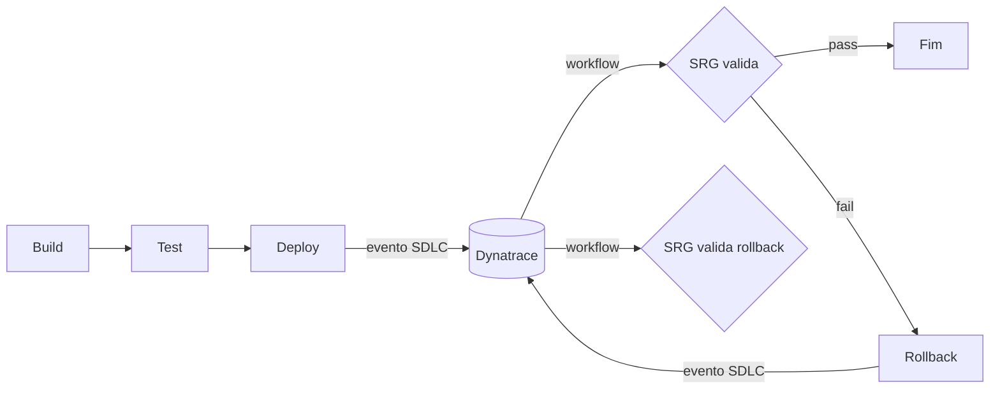

# Pipeline Rollback Demo

Demo de pipeline com rollback automatizado validado pelo Site Reliability Guardian (SRG) do Dynatrace, com visão de quantidade e saúde dos rollbacks.

## Fluxo

1. Build, test e deploy (GitHub Actions + Kubernetes).
2. O deploy envia eventos SDLC ao Dynatrace.
3. Um workflow do Dynatrace, disparado pelo evento, executa o SRG.
4. A pipeline aguarda o resultado ([scripts/wait-srg.sh](scripts/wait-srg.sh)); em falha executa `kubectl rollout undo`.
5. O rollback também emite eventos e é validado novamente pelo SRG.

## Estrutura

| Caminho | Conteúdo |
|---|---|
| [app/](app/) | App Node.js; `FAIL_RATE` simula uma versão ruim |
| [k8s/](k8s/) | Manifests com labels/env para Release Monitoring |
| [.github/workflows/pipeline.yml](.github/workflows/pipeline.yml) | Pipeline |
| [scripts/](scripts/) | Envio de eventos SDLC e espera do SRG |
| [dynatrace/guardian.yaml](dynatrace/guardian.yaml) | Objetivos do SRG |
| [dynatrace/rollback-queries.dql](dynatrace/rollback-queries.dql) | DQL: contagem, taxa, saúde e duração dos rollbacks |

## Configuração

- Variável do repositório: `DT_ENV_URL` (ex.: `https://<tenant>.apps.dynatrace.com`).
- Secrets: `DT_CLIENT_ID`, `DT_CLIENT_SECRET`, `DT_ACCOUNT_URN` (OAuth client com escopos `storage:events:read`, `storage:bizevents:read`, `storage:buckets:read`, `openpipeline:events.sdlc:ingest`) e `KUBECONFIG_B64`.
- No Dynatrace: criar o guardian conforme [dynatrace/guardian.yaml](dynatrace/guardian.yaml) e um workflow com trigger em eventos SDLC (`deployment.type` = `deploy` ou `rollback`, `event.type` = `finished`) que execute a ação do SRG.
- Release Monitoring: manter as labels `app.kubernetes.io/version` e `app.kubernetes.io/part-of`.

## Rodando a demo

1. Execute o workflow com `fail_rate=0`: deploy saudável, SRG passa.
2. Execute com `fail_rate=0.5`: SRG falha, rollback automático para a revisão anterior, SRG valida o rollback.
3. Use as queries de [dynatrace/rollback-queries.dql](dynatrace/rollback-queries.dql) em um notebook/dashboard.

## Pontos a validar no seu tenant

- Nome do evento e campos que o SRG emite ao concluir (usados em `wait-srg.sh` e na query 3).
- Nomes das métricas nos objetivos do SRG, conforme sua coleta Kubernetes/serviços.
- Os campos `deployment.type` e `deployment.id` são customizados; o evento SDLC aceita atributos adicionais.
- Thresholds, janela e tratamento de falta de dados em `guardian.yaml` são valores iniciais.
